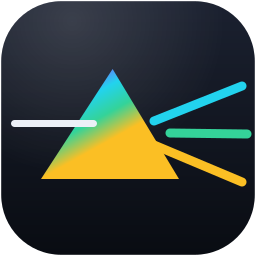

<p align="center">
  
</p>

<h1 align="center">DeTube</h1>

<p align="center">
  <strong>YouTube provides the content. DeTube decides how it is discovered.</strong><br />
  A neutral, user-controlled discovery feed for YouTube — with no behavioural recommendation
  engine deciding what you see.
</p>

<p align="center">
  <a href="https://github.com/dineshkn-dev/detube/actions/workflows/ci.yml"></a>
  
  <a href="LICENSE"></a>
  
  
  
</p>

---

## Contents

- [Why](#why)
- [Features](#features)
- [Install](#install)
- [Configure](#configure)
- [How the feed is built](#how-the-feed-is-built)
- [Privacy](#privacy)
- [Permissions](#permissions)
- [Architecture](#architecture)
- [Design](#design)
- [Development](#development)
- [Testing](#testing)
- [Known limitations](#known-limitations)
- [Contributing](#contributing)
- [License](#license)

## Why

YouTube's home feed is ranked by a model whose objective is engagement with _you_: it learns from
your watch history, dwell time and clicks. That is a legitimate design, but it means you no longer
choose what you browse — you are shown what you are predicted to keep watching.

DeTube keeps the part of YouTube that is useful (a grid of videos to browse) and replaces the part
that is not (the implicit behavioural ranking) with something you control:

> The feed is assembled from YouTube's **general** sources — trending charts, category charts, channel
> uploads, topic searches — and ranked by a deterministic engine you configure. Personalisation comes
> only from choices you make deliberately.

If you want Technology and Programming, you get Technology and Programming. If you never want to see
Gaming, it is gone. Nothing is inferred from what you click.

## Features

- **Neutral feed** on the YouTube home page — trending, category charts, topic searches and channel
  uploads, with your own topics on top.
- **Deterministic ranking**: freshness + general popularity + topic relevance + channel/category
  diversity + a seeded, controllable shuffle. Not tuned for watch time, click-through or session
  length.
- **Explicit personalization only**: toggle categories, add custom topics, allow/deny channels,
  optionally connect subscriptions. No behaviour is ever measured.
- **Content filters**: hide Shorts (best-effort heuristic), hide livestreams, duration bounds, and an
  opt-in clickbait heuristic.
- **A feed that ends**: "You've reached the end of today's feed." plus an optional _Load more_ button.
  No infinite autoplay, no artificial urgency.
- **Graceful degradation**: if the API, your quota, the network or your key fails, YouTube's own home
  is restored and a compact banner explains what happened. YouTube is never broken by DeTube.
- **Zero runtime dependencies**, no telemetry, and a least-privilege permission set.

## Install

DeTube is not on the Chrome Web Store yet — build it from source.

**Requirements:** Node.js ≥ 20, and Chrome/Chromium ≥ 120.

```bash
git clone https://github.com/dineshkn-dev/detube.git
cd detube
npm install --include=dev   # --include=dev guards against npm configs that omit dev deps
npm run build               # bundles everything into dist/
```

Then in Chrome:

1. Open `chrome://extensions`
2. Enable **Developer mode** (top right)
3. Click **Load unpacked** and select the `dist/` folder
4. Pin DeTube from the puzzle-piece menu

After changing source, run `npm run build` (or `npm run dev` to watch) and hit the reload icon on the
extension card, then reload the YouTube tab.

> **Note on `manifest.json`:** it ships a placeholder `oauth2.client_id`. If Chrome refuses to load the
> extension because of it, either supply a real Chrome Extension OAuth client ID (only needed for the
> Subscriptions feed) or delete the `oauth2` block and rebuild. Everything else works without it.

## Configure

Open the extension's **Options** page (or the popup → **Settings**).

### 1. Add a YouTube Data API key

Create one in the [Google Cloud Console](https://console.cloud.google.com/): create a project →
**APIs & Services → Library** → enable **YouTube Data API v3** → **Credentials → Create credentials →
API key**. Restrict it to the YouTube Data API. Then paste it into Options → **Connection**.

Bring-your-own-key means the key is yours, stays in `chrome.storage.local`, and spends your own
10,000 units/day quota. The extension never ships a shared key.

### 2. (Optional) Connect subscriptions

The Subscriptions feed needs OAuth, because there is no key-only way to read your subscription list.
Register a **Chrome Extension** OAuth client in the Cloud Console and put its ID in
`manifest.json` → `oauth2.client_id`, then **Connect YouTube account** in Options.

This requests exactly one scope — `https://www.googleapis.com/auth/youtube.readonly` — and is used
only to read your subscriptions. Watch history is never read. The rest of DeTube works without it.

## How the feed is built

```
candidate videos
      │  dedupe
      ▼  filter      → Shorts / livestreams / duration bounds / excluded channels / clickbait
   scoring          → freshness · general popularity · topic relevance
      ▼  diversity   → per-channel and per-category caps
     rank           → deterministic order: dedupe → filter → classify → score → diversify → shuffle
      ▼  shuffle    → seeded, so the feed is stable for a day but not forever
  final feed
```

Ranking is a pure function of the candidate set, the clock and the seed — which is why it is
unit-tested with an explicit `nowMs` and `seed` rather than the wall clock.

| Source          | Endpoint                                               | Quota            | Notes                                                                                            |
| --------------- | ------------------------------------------------------ | ---------------- | ------------------------------------------------------------------------------------------------ |
| Trending        | `videos.list?chart=mostPopular`                        | 1 unit           | Region-level chart. **Not personalized.**                                                        |
| Category chart  | `…&videoCategoryId=…`                                  | 1 unit           | One category per call.                                                                           |
| Channel uploads | `channels.list` + `playlistItems.list` + `videos.list` | ~3 units         | Powers _include channels_ and subscriptions. Cheaper and more reliable than search for "latest". |
| Topic / custom  | `search.list`                                          | 1 of **100/day** | Separate bucket. Cached hard; skipped when exhausted.                                            |
| Subscriptions   | `subscriptions.list?mine=true`                         | 1 unit           | OAuth only.                                                                                      |

The default quota is **10,000 units/day** plus a **separate 100-call/day search budget**. The Options
page shows live consumption, and a `403 quotaExceeded` becomes a friendly notice rather than a
broken page.

## Privacy

No servers, no analytics, no telemetry, no tracking. Settings and your API key live only in
`chrome.storage.local`; the only outbound requests are to `https://www.googleapis.com/youtube/v3/*`;
API responses are cached in memory and never written to disk.

Read the full [Privacy Policy](PRIVACY.md).

## Permissions

| Permission                                       | Why it is needed                                  | What it can access                          | Required?              |
| ------------------------------------------------ | ------------------------------------------------- | ------------------------------------------- | ---------------------- |
| `storage`                                        | Persist settings and a local daily quota counter  | Extension-local storage only                | Yes                    |
| `identity`                                       | OAuth for the Subscriptions feed                  | `youtube.readonly` — your subscription list | Only for subscriptions |
| `host_permissions: https://www.googleapis.com/*` | Call the YouTube Data API from the service worker | Requests to that host                       | Yes                    |
| `content_scripts: https://www.youtube.com/*`     | Render the feed over the home grid                | The YouTube page DOM                        | Yes                    |

Deliberately **not** requested: `tabs`, `activeTab`, `webRequest`, `scripting`, `cookies`,
`<all_urls>`, `history`.

## Architecture

```
content script        YouTube DOM integration only (HomePageAdapter + Shadow-DOM feed)
background worker     the only place that touches the network
  api/                typed YouTube client, response parsers, quota tracker, TTL cache
  sources/            Trending · Category · ChannelUploads · SearchTopic · Subscription
  feed/               categories · filter · ranker · diversity · FeedService   ← pure TS
  auth/               chrome.identity OAuth (youtube.readonly)
storage/              typed chrome.storage.local settings with defaults + migration
options/ popup/       vanilla-TS extension pages
ui/                   shared design tokens and the prism brand mark
```

The **feed engine is pure TypeScript with no browser APIs**, so it is exercised in plain Node. All
knowledge of YouTube's markup is isolated behind `HomePageAdapter`; the feed is mounted inside a
**Shadow DOM**, so page styles cannot leak in and ours cannot leak out. YouTube's own home grid is
hidden — never destroyed — and restored on any failure.

<details>
<summary>Repository layout</summary>

```
src/
  background/
    api/            client, parsers, quota, cache
    auth/           OAuth helper
    feed/           categories, filter, ranker, diversity, FeedService
    messaging/      typed content ↔ worker contract
    sources/        one module per discovery source
    serviceWorker.ts
  content/
    ui/             renderer, cards, icons, motion, mark
    youtube/        home adapter + feed replacer
  options/  popup/  ui/  storage/  shared/  types/
tests/              vitest (jsdom + node)
scripts/            build pipeline + dependency-free icon generator
design/             logo.svg
```

</details>

## Design

The interface is built on a **prism** motif: white light split into a calm spectrum, for "neutral".
The spectrum is an accent, never a wash.

- **Brand mark** — a prism drawn purely in CSS (`clip-path` over a gradient) in `src/ui/brand.css`, so
  it is CSP-safe and needs no network request.
- **Icons** — Chrome requires raster icons, so `scripts/icons.mjs` rasterises the mark with
  signed-distance geometry and encodes PNGs using only Node's built-in `zlib`. **No image dependency
  is added** (`sharp`/`canvas` would be supply-chain risk). Three detail tiers keep the mark legible
  from 16px to 128px.
- **One source of truth for style** — `src/ui/tokens.css` holds the semantic tokens (colour, radius,
  space, motion) and feeds all three surfaces: the Shadow-DOM feed through a build-time `cssText`
  esbuild plugin, and Options/Popup through bundled `@import`. No CSS is duplicated.
- **Theming** — the feed follows YouTube's own dark attribute; Options and the popup follow
  `prefers-color-scheme`.
- **Motion** — soft fades, spring hover lifts, a spectral sheen across thumbnails, a seeded reveal on
  scroll, and a one-shot sweep when you reshuffle. Everything animates only `transform`/`opacity`, and
  all of it is disabled under `prefers-reduced-motion`.

## Development

```bash
npm run dev         # esbuild watch → dist/
npm run build       # one-off bundle + icon generation
npm run icons       # regenerate the PNG icon set only
npm run typecheck   # tsc --noEmit
npm run lint        # eslint
npm run format      # prettier --write
npm test            # vitest run
npm run verify      # everything CI runs: typecheck, lint, format check, tests, build
```

`npm run verify` is the gate — please run it before opening a pull request.

## Testing

105 unit tests across 15 files, split between pure logic (ranking, filtering, diversity,
randomization, parsing, settings, quota) and DOM behaviour (feed rendering, home-page adapter).

```bash
npm test            # single run
npm run test:watch  # watch mode
```

Files needing Node built-ins declare `// @vitest-environment node`; everything else runs in jsdom.

## Known limitations

Stated honestly, because pretending otherwise helps nobody:

- **Shorts detection is a heuristic.** The YouTube API exposes no Shorts flag, so DeTube uses duration
  (≤ 60s) plus a vertical-thumbnail check. It can be wrong in both directions.
- **Clickbait detection is a heuristic**, off by default, and will produce false positives.
- **Programming and Science are search-backed.** YouTube's category taxonomy has no Programming
  category and merges Science + Technology into category 28. Categories are therefore a mix of chart
  and search sources.
- **Trending depth is bounded** — the chart returns at most 50 items per region/category.
- **`search.list` is scarce** — 100 calls/day, separate from the 10,000-unit budget. DeTube caches it
  hard and degrades gracefully when it runs out.
- **Home-feed replacement depends on YouTube's markup.** If `ytd-rich-grid-renderer` disappears,
  DeTube backs off and leaves YouTube untouched rather than guessing.

## Contributing

Contributions are welcome — see [CONTRIBUTING.md](CONTRIBUTING.md) for setup, the commit/PR
conventions, and the project invariants. The important ones: no behaviour-derived personalization, no
telemetry, no `eval`, no `innerHTML`, no new permissions without a concrete need, and runtime
dependencies stay at zero.

Please also read the [Code of Conduct](CODE_OF_CONDUCT.md). Security issues go through
[SECURITY.md](SECURITY.md), not the public issue tracker.

## License

[MIT](LICENSE) © Dinesh K N

---

**Disclaimer:** DeTube is an independent project. It is not affiliated with, endorsed by, or
sponsored by YouTube or Google. It uses the YouTube Data API, and use of that API is subject to the
[YouTube API Services Terms of Service](https://developers.google.com/youtube/terms/api-services-terms-of-service)
and [Google's Privacy Policy](https://policies.google.com/privacy). All videos remain the property of
their creators and are played on YouTube.
